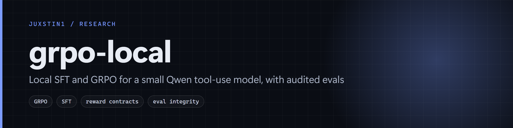
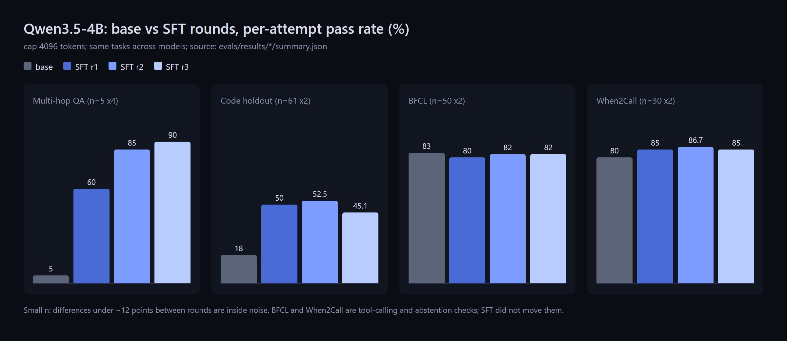
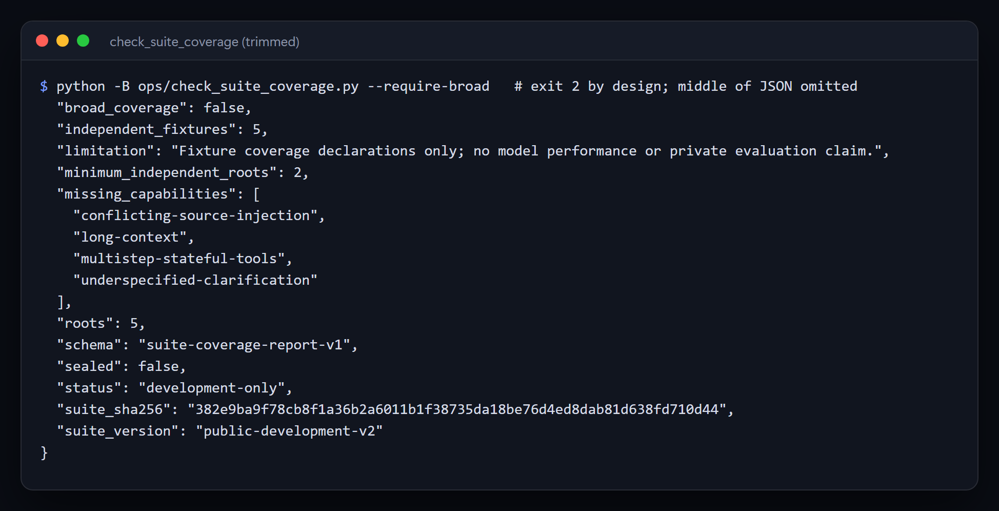

<p align="center"></p>

**Local SFT and GRPO post-training of Qwen3.5-4B for tool use, with the evaluation and reward checks written down.**

<p align="center"></p>

*Base vs three SFT rounds, per-attempt pass rate. Built from `evals/results/*/*.summary.json` (listed under Results).*

## What it does

- Trains Qwen3.5-4B with LoRA: SFT on the model's own verified wins, then GRPO.
- Evaluates with a resumable runner that scores per bucket, never as one blended number.
- Treats request errors as invalid attempts, not as failures or results.
- Grades tool-use tasks in gyms: `sandbox-gym` (file tools), `handoff-gym` (continuation notes), `tau2-bridge`.
- Audits its own rewards and seals: counterexamples that earn false credit are documented and tested.
- Admits SFT data only with registered inputs, token fidelity and verifier replay.

## Results

All numbers are per-attempt pass rate, Qwen3.5-4B, 4096-token cap, small n.

| Eval | base | SFT r1 | SFT r2 | SFT r3 |
| --- | ---: | ---: | ---: | ---: |
| Multi-hop QA, 5 tasks x4 | 5% | 60% | 85% | 90% |
| Code holdout, 61 tasks x2 | 18.0% | 50.0% | 52.5% | 45.1% |
| BFCL, 50 tasks x2 | 83% | 80% | 82% | 82% |
| When2Call, 30 tasks x2 | 80% | 85% | 86.7% | 85% |

Sources: [base QA](evals/results/qwen3.5-4b-base-mhqa-w3-cap4096/mhqa.summary.json),
[r1](evals/results/r1-pilot34-pc5-cap4096/mhqa.summary.json),
[r2](evals/results/r2-pc5-cap4096/mhqa.summary.json),
[r3](evals/results/r3-pc5-cap4096/mhqa.summary.json),
[ood-base](evals/results/ood-base/), [ood-r1](evals/results/ood-r1/),
[ood-r2](evals/results/ood-r2/), [ood-r3](evals/results/ood-r3/).
Round-by-round notes: [runs/LOG.md](runs/LOG.md).

- The base model fails multi-hop QA mostly by hitting the token cap: 95% of attempts. SFT cuts this to 10%.
- The code gain is mostly base to r1. r2 and r3 differ by less than the noise of two 122-attempt runs.
- BFCL and When2Call are flat. SFT did not improve tool calling or abstention.
- The multi-hop QA set is 5 tasks. Treat 90% as a pilot signal, not a benchmark.
- The "sealed" code holdout is not confidential. See [the seal audit](docs/AUDIT-SUITE-SEAL-2026-10-26.md).
- No GRPO result is reported. GRPO ran only as pilot legs ([notebook/Runs.md](notebook/Runs.md)); the later work audited the reward first.
- The 2B run in `evals/results/qwen3.5-2b` is not a baseline. Its server dropped mid-run and most attempts are request errors.

## Evaluation integrity

- [Reward audit](docs/AUDIT-REWARD-2026-10-26.md): the old binary reward gave full credit to wrong work. 11 of 19 selected counterexamples were falsely accepted.
- [Seal audit](docs/AUDIT-SUITE-SEAL-2026-10-26.md): a checksum stored in the same JSON as the answers does not make a seal.
- [Teacher data audit](docs/TEACHER-REPAIR-2026-10-26.md): 617 historical SFT rows are marked legacy and unreplayed, not declared correct.
- Pod evals that ran model code without a sandbox were discarded and renamed `INVALID-unsandboxed` ([notebook](notebook/Log/2026-09-30.md)).
- [Public suite](suite-v2/README.md): 5 outcome-checked roots. `ops/check_suite_coverage.py --require-broad` fails by design because 4 capabilities have no root.

<p align="center"></p>

*Real output of `ops/check_suite_coverage.py --require-broad`, middle of the JSON omitted. Runs offline.*

## How it works

```
base Qwen3.5-4B -> eval (per bucket) -> collect own wins -> admission checks
        -> SFT (LoRA r=8) -> re-eval -> GRPO with a contract-checked reward
```

1. `evals/eval_runner.py` scores each bucket and resumes by (item, attempt).
2. `sft/collect.py` gathers wins. `sft/admission.py` rejects rows without bound evidence.
3. `sft/train_sft.py` trains the LoRA adapter.
4. Gyms in `sandbox-gym/` run the agent against seeded workspaces with jailed tools and mechanical graders.
5. Reward contracts in `ops/reward_contract.py` define what counts as completed work.

## Quick start

Offline checks need Python 3.12 and `pip install -r requirements-offline.txt`. No GPU, model or network.

```
python -m pytest tests -q           # 223 tests
python -B ops/qualify_offline.py    # contract qualification with network and model-import tripwires
python -B ops/check_suite_coverage.py
```

Training and evaluation need a GPU and a vLLM server with LoRA enabled. `evals/eval_runner.py` refuses to run models unless you pass `--allow-model-run`. Serving commands are in [docs/state.md](docs/state.md). Pod addresses are shown as `<pod-ip>`.

## Layout

- `evals/`: datasets, runner, graders, sealing, saved results.
- `sft/`: SFT collection, admission checks, trainer.
- `sandbox-gym/`: file-tool workspace harness and graders.
- `handoff-gym/`, `tau2-bridge/`: continuation and tau2 evaluation harnesses.
- `suite-v2/`: public outcome-contract tasks and coverage inventory.
- `ops/`: reward contracts, audits, offline qualification, run supervision.
- `tests/`: offline tests.
- `docs/`: audits and repair notes. The previous README is in [docs/DETAILS.md](docs/DETAILS.md).
- `notebook/`, `runs/`: run register and per-round logs.

## Status

- Works: SFT rounds r1-r3, per-bucket evaluation, offline qualification, reward and seal audits.
- Open: no repaired GRPO run; the suite covers 5 roots and lacks 4 required capabilities.
- Open: no confidential final evaluator exists. Final evaluation is disabled until one does.
- Next: add independent task roots, replay historical wins, then retrain under the repaired reward.
